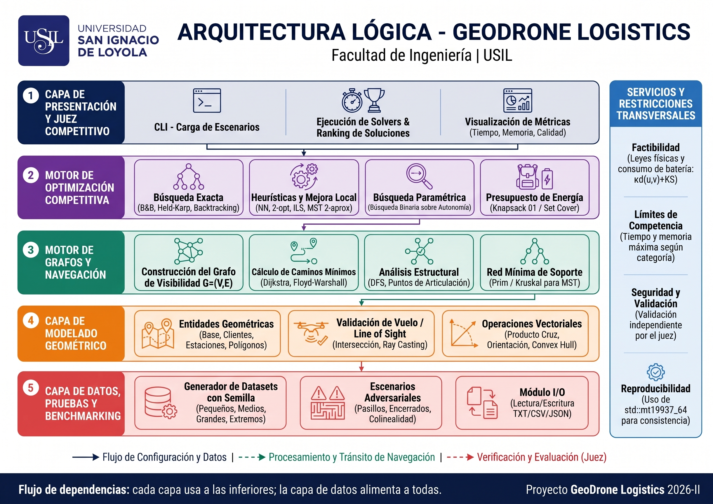

# GeoDrone Challenge

Motor en C++17 para planificar misiones de entrega con un dron: lee un escenario
(base, clientes, estaciones de recarga y edificios), construye un grafo de visibilidad
y calcula la ruta de menor costo respetando los edificios y la batería.
Incluye un solver exacto (branch and bound con programación dinámica de recargas), un heurístico,
un verificador independiente, un generador de casos y un benchmark reproducible.

## Estructura

| Carpeta / archivo | Contenido |
|---|---|
| `engine/include/`, `engine/src/` | Motor: geometría, grafo de visibilidad, caminos mínimos, alcanzabilidad, autonomía mínima, planificador de estaciones, solver exacto y heurístico |
| `engine/src/main_*.cpp` | Programas: `main_solver`, `main_generator`, `main_bench`, `main_planner`, `main_network` |
| `engine/src/judge.cpp` | Verificador de rutas, independiente del solver |
| `engine/tests/` | Pruebas unitarias de cada módulo |
| `server/` | Servidor Node.js que expone el motor |
| `web/` | Interfaz web (Vite) |
| `scripts/` | `generar_datasets.sh`, `correr_bench.sh`, `calcular_gap.sh`, `resumen_bench.sh` |
| `data/` | Escenarios de ejemplo; `data/gen/` guarda los generados |
| `docs/` | Formato de entrada, imagen de arquitectura y resultados del benchmark |

## Arquitectura



Flujo del motor:

1. **Lectura y validación** del escenario (`io`).
2. **Grafo de visibilidad** (`visibility`): nodos de base, clientes, estaciones y vértices de edificios; una arista existe si el vuelo recto no entra al interior de ningún obstáculo.
3. **Caminos mínimos** (`shortest_path`): Dijkstra desde cada nodo de interés.
4. **Alcanzabilidad** (`reachability`): detecta clientes encerrados o fuera de la red de recarga (caso INFEASIBLE).
5. **Solvers**:
   - `solver_heur`: vecino más cercano + mejora local (2-opt y búsqueda aleatoria), reproducible por semilla.
   - `solver_exact`: branch and bound sobre el orden de clientes, con programación dinámica para elegir dónde recargar. Puede arrancar desde la ruta del heurístico como cota superior inicial.
6. **Juez** (`judge`): verifica la ruta sin usar el solver (visibilidad de cada tramo, autonomía y visita de todos los clientes).

## Compilar

Requiere `g++` con C++17 y CMake. En Ubuntu, desde la raíz del proyecto:

```bash
cmake -S engine -B engine/build -DCMAKE_BUILD_TYPE=Release
cmake --build engine/build -j
```

Los ejecutables quedan en `bin/`.

## Uso

**Resolver un escenario**

```bash
./bin/main_solver data/ejemplo.txt
```

Salida esperada: `STATUS FEASIBLE`, `COST 27.605` y la ruta `B C2 C1 S1 W1.1 B`.
`B` es la base, `C#` un cliente, `S#` una estación y `W#.#` una esquina de edificio usada como punto de paso.

**Generar escenarios**

```bash
./bin/main_generator <categoria> <semilla> <tipo> > archivo.txt
bash scripts/generar_datasets.sh     # regenera todos los casos de data/gen/
```

- `categoria`: `Small`, `Medium`, `Large` o `Extreme`.
- `semilla`: número entero. La misma semilla produce siempre el mismo archivo.
- `tipo`: `aleatorio`, `colineal`, `encerrado`, `limite` o `pasillo`.

**Pruebas unitarias**

```bash
for t in bin/test_*; do echo "== $t"; "$t" > /dev/null 2>&1 && echo OK || echo FALLO; done
```

## Benchmark

`main_bench` corre **un caso y un algoritmo por proceso**, de modo que `memoria_mb` es el pico real de ese caso:

```bash
./bin/main_bench [--no-header] <exacto|heur> <caso.txt>
```

Benchmark completo (todos los casos de `data/gen/`, ambos algoritmos) y cálculo del gap:

```bash
bash scripts/correr_bench.sh          # escribe docs/resultados_bench.csv
bash scripts/calcular_gap.sh          # escribe docs/resultados_con_gap.csv
bash scripts/resumen_bench.sh > docs/resumen_bench.md
```

Conviene no ejecutar otros procesos pesados durante la corrida: los solvers se cortan por tiempo real y la carga de la máquina afecta los resultados.

### Metodología

- **Exacto con arranque desde el heurístico.** El heurístico corre primero con el 60 % del presupuesto y su ruta se pasa al exacto como cota superior inicial. El exacto usa el tiempo restante. La fracción se cambia con la variable `FRAC_HEUR`.
- **Límites por categoría.** Tiempo: Small 1 s, Medium 2 s, Large 5 s, Extreme 10 s. Memoria: 64, 128, 256 y 512 MB. El solver usa el 90 % del tiempo menos lo que ya gastaron lectura, grafo y alcanzabilidad.
- **Referencia del gap** (`tipo_ref`):
  - `optimo`: el exacto terminó (`parcial = NO`) con ruta factible y válida. Se usa su costo.
  - `mejor_conocida`: en los demás casos, el menor costo factible válido entre los dos algoritmos.
  - `gap_pct = 100 · (costo − ref) / ref` y `calidad_pct = 100 · ref / costo`.
  - Los gaps contra `optimo` y contra `mejor_conocida` **no son comparables** y se reportan por separado.

### Columnas del CSV (22)

`caso, categoria, clientes, estaciones, poligonos, estado, costo, tiempo_ms, algoritmo, memoria_mb, recargas, parcial, veredicto, motivo, tipo, semilla, t_mejor_ms, nodos_explorados, mejor_conocido, tipo_ref, gap_pct, calidad_pct`

- `parcial`: `SI` si el exacto agotó su tiempo sin probar optimalidad; `NO` si terminó; `NA` para el heurístico.
- `t_mejor_ms`: instante, medido desde el inicio del solver, en que se halló la mejor ruta.
- `nodos_explorados`: nodos del árbol de búsqueda (solo el exacto).

| Veredicto | Significado |
|---|---|
| AC | Ruta válida y dentro de tiempo y memoria (o infactibilidad detectada correctamente) |
| WA | La ruta no pasa el verificador, o el solver no halló ruta existiendo una |
| TLE | Excede el tiempo máximo de la categoría |
| MLE | Excede la memoria máxima de la categoría |
| RE | No se pudo leer el archivo |

### Resultados

**Por categoría y algoritmo**

| Categoría | Algoritmo | Filas | Tiempo prom. (ms) | Tiempo máx. (ms) | Memoria máx. (MB) | Parcial (SI) | Gap prom. (%) | Gap máx. (%) |
|---|---|---|---|---|---|---|---|---|
 Small | exacto | 20 | 195 | 900 | 4.2 | 4 | 0.000 | 0.000 |
 Small | heur | 20 | 5 | 10 | 4.2 | 0 | 2.035 | 11.450 |
 Medium | exacto | 20 | 1711 | 1801 | 4.7 | 19 | 0.000 | 0.000 |
 Medium | heur | 20 | 121 | 548 | 4.7 | 0 | 0.273 | 1.962 |
 Large | exacto | 9 | 4010 | 4519 | 8.9 | 8 | 0.331 | 1.158 |
 Large | heur | 9 | 3243 | 4500 | 8.6 | 0 | 0.000 | 0.000 |
 Extreme | exacto | 7 | 7931 | 9133 | 41.4 | 6 | 2.426 | 8.877 |
 Extreme | heur | 7 | 7889 | 9006 | 38.9 | 0 | 0.000 | 0.000 |

**Gap del heurístico según el tipo de referencia**

| Referencia | Casos | Gap prom. (%) | Gap máx. (%) |
|---|---|---|---|
| mejor_conocida | 37 | 0.145 | 1.962 |
| optimo | 15 | 2.566 | 11.450 |

**Gap del heurístico por tipo de caso**

| Tipo | Casos | Gap prom. (%) | Gap máx. (%) |
|---|---|---|---|
| aleatorio | 40 | 0.836 | 11.450 |
| colineal | 4 | 0.359 | 1.437 |
| limite | 4 | 0.000 | 0.000 |
| pasillo | 4 | 2.240 | 7.000 |

**Veredictos**

| Veredicto | Filas |
|---|---|
| AC | 112 |

Notas para leer las tablas:
- Los casos de tipo `encerrado` son infactibles y no tienen costo, por eso no entran en los gaps.
- Solo hay referencia `optimo` en Small (15 de sus 19 casos factibles). En los otros 4 de Small y en todo Medium, Large y Extreme el exacto agota su tiempo, así que el gap es contra la mejor ruta conocida.
- En Large y Extreme el heurístico ejecutado solo supera al exacto (gap promedio del exacto 0.331 % y 2.426 %, máximo 1.158 % y 8.877 %). El exacto recibe el heurístico con solo el 60 % del presupuesto y el B&B casi no mejora esa ruta, por lo que ahí el heurístico es la mejor opción.

## Limitaciones del modelo

El formato de entrada admite, para cada cliente, prioridad, marca de obligatorio, ventana de tiempo [e, l] y demanda. La implementación actual trata a todos los clientes como obligatorios y minimiza la distancia recorrida, respetando la autonomía del dron y los obstáculos. El consumo por servicio (`s`) sí se modela. Las ventanas de tiempo, las prioridades, los clientes opcionales y la demanda se leen del archivo pero no condicionan la ruta. Los casos del benchmark usan ventanas no restrictivas (e = 0, l = 1000000) y todos los clientes obligatorios, por lo que esta simplificación no afecta los resultados reportados. Incorporar estos aspectos requeriría modelar el tiempo en la programación dinámica de recargas, ampliar la cota inferior del exacto y extender el juez.

Otras limitaciones:
- Una sola base y un solo dron, con una sola ruta.
- Con muchos clientes el solver exacto agota su tiempo y entrega la mejor ruta encontrada (`parcial = SI`), sin garantía de óptimo. En el benchmark esto ocurre en 4 de 19 casos Small factibles y en casi todos los de Medium, Large y Extreme.
- No se hizo un estudio de escalabilidad del exacto con tamaños intermedios; el comportamiento se describe por categoría.
